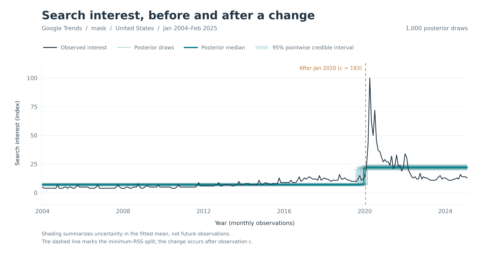

# Bayesian Change-Point Analysis of Google Trends Data

**Zhekai Liu | UC Berkeley STAT 153, Spring 2025 | Homework 2, Problem 3**

This is a cleaned-up version of a coursework example. It uses a Bayesian single-change-point model to study US search interest in **mask**. The goal is to estimate when the average search interest changed and describe uncertainty in the change point and the fitted mean function.

The example demonstrates regression modeling, marginal posterior calculations, direct posterior sampling, and model checking. It is a course exercise, not a new statistical method.

## Data and question

The included Google Trends export has 254 monthly observations, from January 2004 to February 2025. The question is whether two average levels, separated by one change point, give a useful summary of the series.

See [data notes](data/README.md) for the source and file format.

## Model and inference

The model is

$$y_t = \beta_0 + \beta_1 I(t > c) + \epsilon_t, \qquad \epsilon_t \overset{\mathrm{iid}}{\sim} N(0,\sigma^2).$$

- $c$ is the one-based index of the last month before the change.
- $\beta_0$ is the mean before the change.
- $\beta_1$ is the difference between the two means.
- $\sigma$ describes noise around the mean function.

The posterior formulas use a uniform prior over $c=1,\ldots,n-1$ and the improper prior $\pi(\boldsymbol\beta,\sigma^2\mid c)\propto1/\sigma^2$. For each candidate $c$, the code fits an OLS regression with design matrix $X_c=[\mathbf{1},I(t>c)]$ and calculates $RSS(c)$. With $p=2$ regression coefficients,

$$p(c\mid y)\propto |X_c^\top X_c|^{-1/2} RSS(c)^{-(n-p)/2}.$$

The code then generates 1,000 parameter draws using

$$c\sim p(c\mid y),$$

$$
\sigma^2 \mid c,y \sim \mathrm{IG}\left(\frac{n-p}{2},\frac{RSS(c)}{2}\right).
$$

$$\boldsymbol\beta\mid\sigma^2,c,y\sim N\left(\widehat{\boldsymbol\beta}_c,\sigma^2(X_c^\top X_c)^{-1}\right).$$

Here the inverse-gamma density is proportional to $v^{-a-1}\exp(-b/v)$. The variance draw is implemented using $\sigma^2=RSS(c)/U$, where $U\sim\chi^2_{n-p}$.

This is direct posterior sampling. Each complete parameter draw is generated independently. The plotted curves are draws of the mean function, not posterior predictive draws of new noisy observations.

## Run

Tested with Python 3.9.7 and the versions listed in `requirements.txt`.

```bash
python -m pip install -r requirements.txt
python bayesian_changepoint.py
```

The defaults use the included dataset, 1,000 draws, and random seed 42. Paths are resolved relative to the script, so the default run does not depend on the terminal's working directory.

Optional arguments:

```bash
python bayesian_changepoint.py --draws 2000 --seed 42 --output-dir results_alt
```

The script writes two figures, a parameter sample table, the discrete change-point posterior, and a JSON summary. Running it again replaces the files in the chosen output directory.

## Results



The figure above uses the original CSV included in this repository: **254 monthly observations from January 2004 through February 2025**, for `mask` in the United States, with category `All categories`.

| Output | Result |
| --- | --- |
| Minimum-RSS change point, `c_est` | `193` |
| Calendar interpretation | The first regime ends in January 2020; the second starts in February 2020 |
| Sampled 95% percentile interval for `c`, `ci_c` | `[187, 194]` |
| Posterior draws / seed | `1,000 / 42` |

The index interval describes possible last observations of the first regime, from July 2019 through February 2020. The plotted dashed line marks the minimum-RSS split. The model estimates a single shift in the mean; the later peak and decline remain visible in the observed series.

## Repository contents

| File | Purpose |
| --- | --- |
| `change_point_analysis.py` | Original inference code with the revised plotting section and a portable input path |
| `requirements.txt` | Versions used to validate the script |
| `.gitignore` | Excludes Python caches, virtual environments, and local editor files |
| `data/multiTimeline.csv` | Original monthly Google Trends data, copied without changes |
| `data/README.md` | Data coverage, format, and provenance |
| `figures/change_point_fit.png` | Actual analysis figure at 300 dpi |
| `figures/change_point_fit.svg` | Scalable version of the actual analysis figure |

## Course sources and preparation

The original analysis was completed for STAT 153 Homework 2, Problem 3, in Spring 2025. The model and posterior sampling procedure follow the course materials taught by Aditya Guntuboyina, especially [Lab 5: Change-point model](https://stat153.berkeley.edu/spring-2025/lab5). See also the [course website](https://stat153.berkeley.edu/spring-2025/).

This repository was prepared from the original `2.3.py` script with assistance from OpenAI Codex. Preparation included organizing the code into functions, using portable paths, caching candidate fits, adding dates and saved outputs, and writing documentation. The inference method is retained. The reported interval now uses exact discrete posterior quantiles rather than quantiles of the sampled change points.
