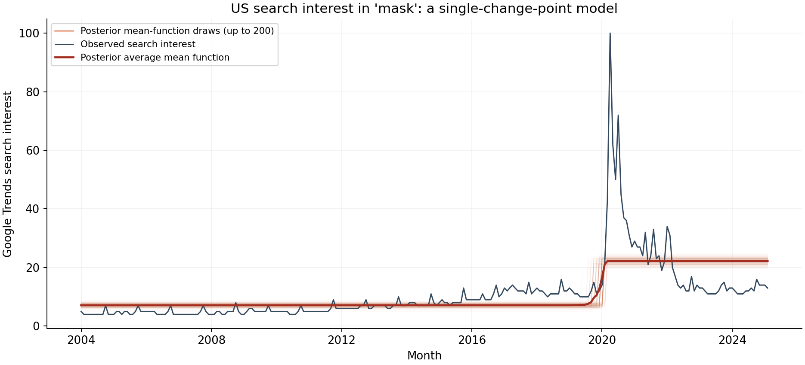
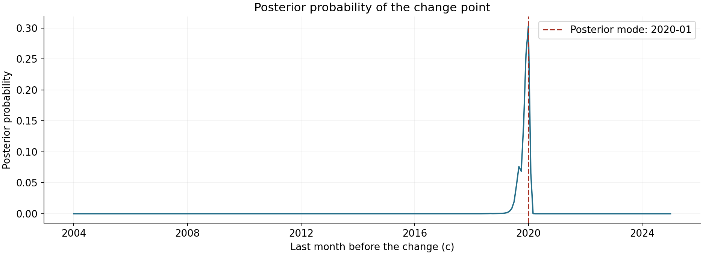

# Bayesian Change-Point Analysis of Google Trends Data

**Zhekai Liu | UC Berkeley STAT 153, Spring 2025 | Homework 2, Problem 3**

This repository contains my original coursework script, `bayesian_changepoint.py` (originally `2.3.py`). The source code is preserved unchanged. The example estimates a single change point in US Google search interest for **mask**, using monthly data from January 2004 through February 2025.

## Question and model

The question is whether the series can be described by two average levels separated by one change point, and how uncertain that change point is.

$$
y_t = \beta_0 + \beta_1 I(t>c) + \epsilon_t, \qquad \epsilon_t \sim N(0,\sigma^2).
$$

Errors are assumed independent. The parameter c is the last month before the change; beta0 is the earlier mean, and beta1 is the difference between the later and earlier means.

## What the original code does

1. Reads the Google Trends CSV.
2. Fits OLS regressions for each candidate change point and selects the one with the smallest residual sum of squares.
3. Calculates and normalizes the marginal posterior probabilities of the change points.
4. Samples 1,000 change points and reports the 2.5th and 97.5th percentiles.
5. Samples the noise standard deviation and regression coefficients from their conditional posterior distributions.
6. Plots the resulting mean functions together with the data.

The posterior formulas correspond to a uniform prior over c = 1, ..., n-1 and a joint prior on the coefficients and variance proportional to 1/sigma^2. This is direct posterior sampling, not Gibbs sampling or MCMC.

## Run the original script

```bash
python -m pip install -r requirements.txt
python bayesian_changepoint.py
```

The script retains its original Windows input path:

```text
D:\google download\multiTimeline (1).csv
```

A copy of that CSV is included under `data/`. To run the script unchanged, place the CSV at the original path. On another system, the reader would need to adjust the input path locally. The script displays plots interactively; it does not save result files itself.

The dependencies were checked with Python 3.9.7. The exact versions used are listed in `requirements.txt`.

## Results and interpretation

The unchanged script reports:

```text
c_est: 193
ci_c: [187. 194.]
```

The estimated change point is January 2020 (month 193), so the new level starts in February 2020. The sampled 95% credible interval runs from month 187 to month 194, or July 2019 through February 2020 as possible last pre-change months.



The figure displays the first 200 of the 1,000 parameter draws from the original script, with lighter lines for readability. The dark red curve averages all 1,000 mean functions. Calendar dates replace month indices on the horizontal axis. These are mean-function draws, not predictions of new noisy observations. The figure below displays the change-point probabilities already computed by the original script. These presentation figures were generated separately; the original script itself has not been modified.



The model describes a change in average level but does not capture the large spike and subsequent decline. Parameter uncertainty is conditional on this simple model; it does not establish that a single permanent change adequately describes the series.

## Data and course sources

The included CSV is the original saved Google Trends export for the query **mask**, United States, All categories, with 254 monthly observations. It contains search-interest values, not raw search counts. Its first two lines are metadata and a blank line. The download date was not recorded.

- [STAT 153 course website](https://stat153.berkeley.edu/spring-2025/)
- [Lab 5: Change-point model](https://stat153.berkeley.edu/spring-2025/lab5), taught by Aditya Guntuboyina; the coursework code follows this model and sampling procedure.
- [Google Trends](https://trends.google.com/trends/)

Documentation and figure styling were prepared with assistance from OpenAI Codex. The coursework source file was not edited.
